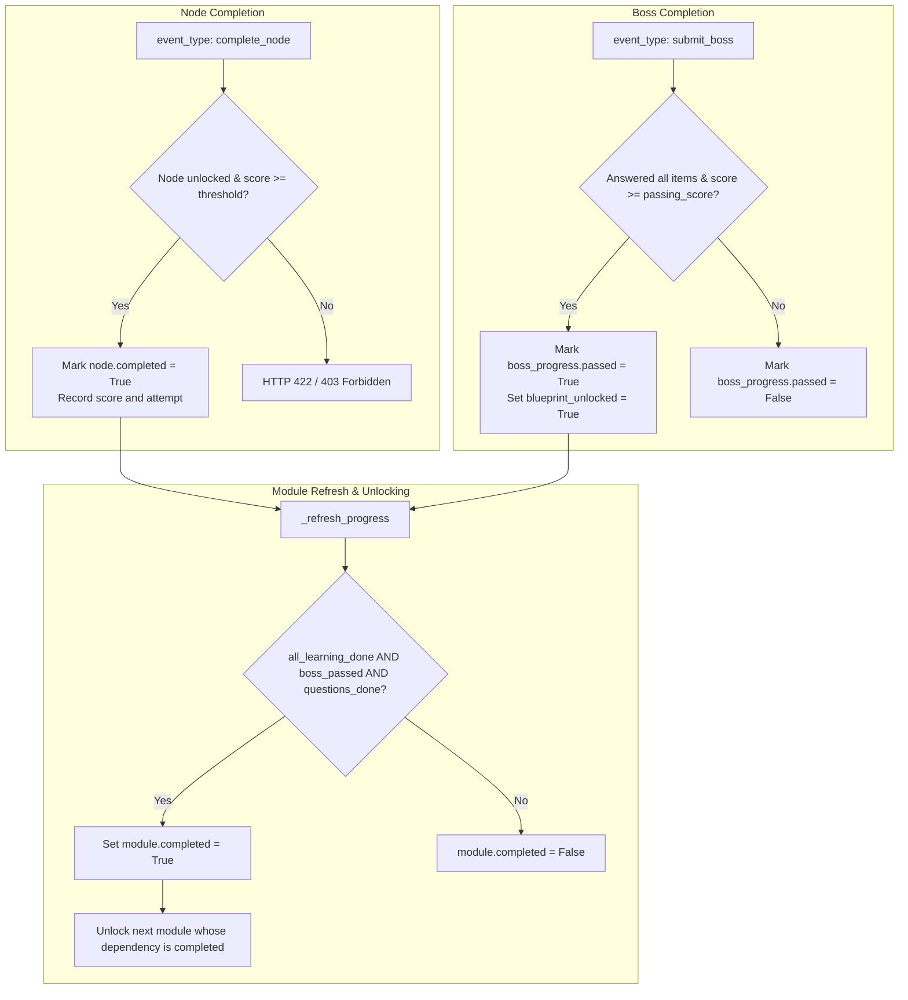

Error: API error (attempt 1): request failed: Post "https://daily-cloudcode-pa.googleapis.com/v1internal:streamGenerateContent?alt=sse": read tcp [2409:40e2:11d6:152f:a9ad:6f92:b1fa:2f53]:54057->[2001:4860:4840:400::]:443: wsarecv: A connection attempt failed because the connected party did not properly respond after a period of time, or established connection failed because connected host has failed to respond. (Error ID: c43c8dc4-243b-416a-aa74-6a41ddff68a1-86)

Errored list all files in gamified-course-prototype
Analyzed schemas.py:L1-100
Errored list files in prototype directory
Analyzed main.py:L1-100
Analyzed preprocessor.py:L1-50
Analyzed agents.py:L1-50
Analyzed __init__.py
Analyzing requirements.txt:L1-50
Analyzing README.md:L1-100
Analyzed jobs_state.json:L1-100
Analyzed schemas.py:L100-250
Analyzed schemas.py:L251-400
Analyzed schemas.py:L401-600
Analyzed schemas.py:L601-800
Analyzed schemas.py:L801-1000
Analyzed schemas.py:L1001-1239
Analyzed main.py:L100-250
Analyzed main.py:L251-500
Analyzed main.py:L501-750
Analyzed main.py:L751-947
Analyzed preprocessor.py:L150-250
Analyzed preprocessor.py:L300-450
Analyzed preprocessor.py:L450-600
Analyzed preprocessor.py:L601-800
Analyzed preprocessor.py:L1100-1296
Analyzed agents.py:L1-200
Analyzed agents.py:L950-1150
Analyzed agents.py:L1151-1235
Analyzed agents.py:L200-350
Analyzed agents.py:L351-500
Analyzed agents.py:L501-545
Analyzed agents.py:L546-570
Analyzed jobs_state.json:L100-160
Analyzed jobs_state.json:L59800-59880

A factual technical audit of the **`gamified-course-prototype`** backend architecture (`c:\Users\Code\Desktop\DoubtDesk\prototypes\gamified-course-prototype`) is detailed below.

---

### 1. Pydantic Models and Fields in `backend/schemas.py`

All models inherit from `ContractModel` (`extra="ignore"`, `str_strip_whitespace=True`, `validate_assignment=True`):

| Model Name | Defined Fields & Types | Purpose / Constraints |
| :--- | :--- | :--- |
| `ContractModel` | *Base configuration class* | Inherits `BaseModel`; extra fields ignored, whitespace stripped. |
| `SourceReference` | `document_id: Identifier \| None`, `document_name: NonEmptyText`, `page_number: int \| None (>=1)`, `slide_number: int \| None (>=1)`, `section_title: ShortText \| None`, `excerpt: str \| None (max 1600)`, `source_hash: str \| None (max 128)` | Document citation provenance. |
| `MediaAsset` | `asset_id: Identifier`, `document_id: Identifier \| None`, `original_filename: NonEmptyText`, `media_type: NonEmptyText`, `storage_path: NonEmptyText`, `source_page: int \| None (>=1)`, `source_slide: int \| None (>=1)`, `asset_kind: Literal["image", "diagram", "chart", "unknown"]`, `surrounding_text: str \| None (max 3000)`, `caption: str \| None (max 1000)`, `extracted_labels: list[NonEmptyText]`, `module_id: Identifier \| None`, `topic_id: Identifier \| None`, `content_hash: str (8-128 chars)` | Extracted image/diagram asset. |
| `ExamPattern` | `name: ShortText`, `question_mark_values: list[int]`, `notes: str \| None (max 1200)` | Mark distributions (default: `[2, 5, 10]`, validated positive and unique). |
| `ExamQuestion` | `question_id: Identifier`, `question_text: NonEmptyText`, `marks: int \| None (>=1)`, `question_number: str \| None (max 40)`, `module_id: Identifier \| None`, `topic: ShortText \| None`, `question_kind: Literal["short_answer", "long_answer", "problem", "case_study", "unknown"]`, `source_refs: list[SourceReference]`, `source_type: Literal["teacher_provided", "ai_generated_supplementary"]`, `source_entry_id: Identifier \| None`, `duplicate_cluster_id: Identifier \| None`, `similarity_kind: Literal["none", "exact_duplicate", "near_duplicate", "related"]`, `related_question_ids: list[Identifier]`, `expected_answer_depth: Literal["brief", "moderate", "extended", "unknown"]`, `related_concepts: list[NonEmptyText]`, `learning_objectives: list[NonEmptyText]`, `prerequisite_concepts: list[NonEmptyText]`, `lifecycle_status: Literal["IMPORTED", "CLASSIFIED", "PREREQUISITES_IDENTIFIED", "TAUGHT", "PRACTISED", "BOSS_ASSESSED", "MASTERED"]`, `learning_content_refs: list[Identifier]`, `practice_refs: list[Identifier]`, `boss_assessment_refs: list[Identifier]`, `verification_status: Literal["unreviewed", "single_model_reviewed", "independent_reviewed", "teacher_review_required"]`, `coverage_status: Literal["unmapped", "mapped", "taught", "practised", "assessed", "mastered"]`, `attempts: int (>=0)`, `best_score: float (0.0 to 1.0)` | Extracted examination question. |
| `QuestionCoverageEntry` | Same field definitions as `ExamQuestion`, plus `original_question_text: NonEmptyText`, `marks_as_supplied: int \| None`, `practice_question_refs: list[Identifier]` | Persistent question ledger entry. |
| `CoverageStats` | `total_original_entries`, `exact_duplicates`, `near_duplicates`, `related_clusters`, `unique_examination_questions`, `questions_mapped`, `questions_taught`, `questions_practised`, `questions_assessed`, `questions_mastered`, `questions_requiring_attention`, `supplementary_questions` (all `int >= 0`) | Ledger coverage metrics. |
| `GenerationTelemetry` | `provider: NonEmptyText`, `requested_model_id: NonEmptyText`, `actual_model_id: str \| None`, `task_type: NonEmptyText`, `prompt_version: NonEmptyText`, `schema_version: NonEmptyText`, `source_document_ids: list[Identifier]`, `source_content_hashes: list[str]`, `timestamp: datetime`, `token_usage: dict[str, int] \| None`, `duration_ms: int \| None (>=0)`, `fallback_history: list[NonEmptyText]`, `verification_result: Literal["awaiting_review", "single_model_reviewed", "independent_reviewed", "teacher_review_required"]` | LLM invocation telemetry. |
| `LessonBlock` | `block_id: Identifier`, `block_type: ShortText`, `heading: NonEmptyText`, `content: str (max 12000)`, `activity: Activity \| None`, `source_refs: list[SourceReference]`, `media_asset_ids: list[Identifier]`, `linked_question_ids: list[Identifier]`, `metadata: dict[str, str]` | Modular instructional unit. |
| `UploadedDocumentInfo` | `document_id: Identifier`, `file_name: NonEmptyText`, `media_type: NonEmptyText`, `file_size_bytes: int (>=0)`, `document_role: Literal["syllabus", "exam_questions", "lecture_material", "other"]` | Ingestion record. |
| `ExtractedTopic` | `topic_id: Identifier`, `title: NonEmptyText`, `description: str \| None (max 2000)`, `learning_outcomes: list[NonEmptyText]`, `source_refs: list[SourceReference]` | Syllabus topic node. |
| `ExtractedModule` | `module_id: Identifier`, `module_number: int (>=1)`, `title: NonEmptyText`, `overview: str \| None (max 3000)`, `topics: list[ExtractedTopic]`, `learning_objectives: list[NonEmptyText]`, `source_refs: list[SourceReference]` | Syllabus module node. |
| `PreprocessedCourseContext`| `course_title: ShortText \| None`, `subject_area: ShortText \| None`, `exam_pattern: ExamPattern`, `documents: list[UploadedDocumentInfo]`, `modules: list[ExtractedModule]`, `exam_questions: list[ExamQuestion]`, `question_coverage_ledger: list[QuestionCoverageEntry]`, `media_assets: list[MediaAsset]`, `lecture_content: str (max 250000)`, `extraction_warnings: list[str]` | Local parser pipeline output. |
| `FillBlankField` | `blank_id: Identifier`, `accepted_answers: list[NonEmptyText] (>=1)`, `explanation: str \| None (max 1000)`, `hint: str \| None (max 1000)` | Slot for fill-in-blank. |
| `FillBlankActivity` | `type: Literal["fill_blank"]`, `instruction: NonEmptyText`, `template: NonEmptyText`, `blanks: list[FillBlankField] (1-20)`, `word_bank: list[NonEmptyText] (1-60)`, `shuffle_word_bank: bool = True` | Activity with word bank validation. |
| `MatchingPair` | `pair_id: Identifier`, `left_text: NonEmptyText`, `right_text: NonEmptyText`, `explanation: str \| None (max 1000)` | Key-value mapping pair. |
| `MatchingPairsActivity` | `type: Literal["matching_pairs"]`, `instruction: NonEmptyText`, `pairs: list[MatchingPair] (2-30)`, `shuffle_right_column: bool = True` | Two-column association test. |
| `OrderingItem` | `item_id: Identifier`, `label: NonEmptyText`, `detail: str \| None (max 1000)` | Sequential stage unit. |
| `OrderingActivity` | `type: Literal["ordering"]`, `instruction: NonEmptyText`, `items: list[OrderingItem] (2-30)`, `correct_order: list[Identifier] (2-30)`, `explanation: str \| None (max 2000)` | Sequence puzzle activity. |
| `ActivityOption` | `option_id: Identifier`, `text: NonEmptyText`, `feedback: str \| None (max 1000)`, `misconception_tag: str \| None (max 100)` | Option choice model. |
| `MCQActivity` | `type: Literal["mcq"]`, `instruction: NonEmptyText`, `question: NonEmptyText`, `options: list[ActivityOption] (2-6)`, `correct_option_id: Identifier`, `explanation: NonEmptyText` | Multiple choice question. |
| `FormulaBlank` | `blank_id: Identifier`, `accepted_answers: list[NonEmptyText] (>=1)`, `unit: str \| None (max 50)` | Formula token slot. |
| `FormulaCompletionActivity` | `type: Literal["formula_completion"]`, `instruction: NonEmptyText`, `expression_template: NonEmptyText`, `blanks: list[FormulaBlank] (1-15)`, `symbol_legend: list[NonEmptyText]`, `explanation: str \| None (max 2000)` | Mathematical equation completion. |
| `CodeTraceStep` | `step_number: int (>=1)`, `prompt: NonEmptyText`, `expected_result: NonEmptyText`, `explanation: str \| None (max 1200)` | Step in code execution. |
| `CodeTracingActivity` | `type: Literal["code_tracing"]`, `instruction: NonEmptyText`, `language: ShortText \| None`, `code: NonEmptyText (max 20000)`, `trace_steps: list[CodeTraceStep] (1-20)` | Code line trace activity. |
| `DiagramTarget` | `target_id: Identifier`, `placeholder: NonEmptyText`, `hint: str \| None (max 500)` | Drop target on diagram. |
| `DiagramMapping` | `target_id: Identifier`, `label_id: Identifier` | Correct label assignment. |
| `DiagramLabelingActivity` | `type: Literal["diagram_labeling"]`, `instruction: NonEmptyText`, `diagram_description: NonEmptyText`, `image_url: HttpUrl \| None`, `targets: list[DiagramTarget] (1-30)`, `label_bank: list[ActivityOption] (1-40)`, `correct_mapping: list[DiagramMapping] (1-30)`, `explanation: str \| None (max 2000)` | Interactive visual diagram. |
| `NumericalProblemActivity` | `type: Literal["numerical_problem"]`, `instruction: NonEmptyText`, `problem_statement: NonEmptyText`, `expected_answer: NonEmptyText`, `accepted_alternatives: list[NonEmptyText]`, `unit: str \| None (max 60)`, `tolerance: float \| None (>=0)`, `solution_steps: list[NonEmptyText] (1-30)`, `final_explanation: str \| None (max 2000)` | Numerical quantitative problem. |
| `ClassificationCategory` | `category_id: Identifier`, `label: NonEmptyText`, `description: str \| None (max 800)` | Categorization bucket. |
| `ClassificationItem` | `item_id: Identifier`, `text: NonEmptyText`, `correct_category_id: Identifier`, `explanation: str \| None (max 1000)` | Card to be classified. |
| `ClassificationActivity` | `type: Literal["classification"]`, `instruction: NonEmptyText`, `categories: list[ClassificationCategory] (2-20)`, `items: list[ClassificationItem] (2-40)` | Multiclass sorting activity. |
| `KeyPointsCheckOption` | `point_id: Identifier`, `text: NonEmptyText`, `is_essential: bool`, `explanation: str \| None (max 1000)` | Rubric line checkbox. |
| `KeyPointsCheckActivity` | `type: Literal["key_points_check"]`, `instruction: NonEmptyText`, `question: NonEmptyText`, `options: list[KeyPointsCheckOption] (3-15)`, `min_required: int (>=1)`, `explanation: str \| None (max 2000)` | Select all essential answers. |
| `ShortAnswerActivity` | `type: Literal["short_answer"]`, `instruction: NonEmptyText`, `prompt: NonEmptyText`, `key_points: list[NonEmptyText] (1-20)`, `sample_response: str \| None (max 4000)`, `self_check_guidance: NonEmptyText` | Open response with self-rubric. |
| `CaseAnalysisQuestion` | `question_id: Identifier`, `prompt: NonEmptyText`, `expected_considerations: list[NonEmptyText] (1-15)` | Sub-question on scenario. |
| `CaseAnalysisActivity` | `type: Literal["case_analysis"]`, `instruction: NonEmptyText`, `case_text: NonEmptyText (max 12000)`, `questions: list[CaseAnalysisQuestion] (1-10)`, `overall_feedback: str \| None (max 2500)` | Scenario-based case analysis. |
| `ConceptExample` | `title: ShortText`, `explanation: NonEmptyText` | Concrete illustration. |
| `VisualAid` | `kind: Literal["diagram", "sequence", "table", "image", "other"]`, `title: ShortText \| None`, `description: NonEmptyText`, `image_url: HttpUrl \| None`, `alt_text: str \| None (max 500)` | Visual representation schema. |
| `ConceptHookScreen` | `screen_type: Literal["concept_hook"]`, `heading: NonEmptyText`, `explanation: NonEmptyText (max 5000)`, `analogy: str \| None (max 2000)`, `examples: list[ConceptExample] (0-8)`, `visual_aid: VisualAid \| None`, `source_refs: list[SourceReference]` | Screen 1 of Stepping Stone. |
| `ExamRubricPoint` | `keyword: NonEmptyText`, `explanation: NonEmptyText`, `importance: Literal["essential", "supporting"]` | Single marking criteria point. |
| `ExamRubricScreen` | `screen_type: Literal["exam_rubric"]`, `heading: NonEmptyText`, `purpose: NonEmptyText`, `points: list[ExamRubricPoint] (1-25)`, `suggested_answer_structure: list[NonEmptyText] (0-20)`, `linked_question_ids: list[Identifier] (0-100)`, `source_refs: list[SourceReference]` | Screen 2 of Stepping Stone. |
| `QuestionPracticeItem` | `question_id: Identifier`, `question_text: NonEmptyText`, `source_type: Literal["teacher_provided", "ai_generated_supplementary"]`, `marks: int \| None (>=1)`, `activity: Activity`, `source_refs: list[SourceReference]`, `linked_original_question_id: Identifier \| None`, `struggle_feedback: str \| None (max 1200)` | Single practice activity entry. |
| `ActiveRecallScreen` | `screen_type: Literal["active_recall"]`, `heading: NonEmptyText`, `question_items: list[QuestionPracticeItem] (0-500)`, `activity: Activity \| None` | Screen 3 of Stepping Stone. |
| `AssessmentItem` | `assessment_item_id: Identifier`, `item_type: Literal["mcq", "fill_blank", "matching_pairs", "ordering", "classification", "diagram_labeling", "formula_completion", "numerical_problem", "short_answer", "long_answer", "case_analysis"]`, `prompt: NonEmptyText`, `marks: int \| None (>=1)`, `original_question_ids: list[Identifier] (1-100)`, `activity: Activity \| None`, `rubric_points: list[NonEmptyText]`, `correct_answer: str \| None (max 4000)`, `accepted_answers: list[NonEmptyText]`, `feedback: str \| None (max 3000)`, `source_refs: list[SourceReference]` | Mapped exam assessment item. |
| `BossAssessment` | `assessment_id: Identifier`, `sections: list[NonEmptyText] (1-10)`, `items: list[AssessmentItem] (1-1000)`, `question_to_item: dict[Identifier, Identifier]`, `passing_score: float (0.0 to 1.0)`, `require_all_items: bool = True`, `source_refs: list[SourceReference]` | Final module exam challenge. |
| `DiagnosticOption` | `option_id: Identifier`, `text: NonEmptyText`, `misconception_tag: Identifier \| None`, `feedback: NonEmptyText` | Diagnostic answer option. |
| `DiagnosticMCQScreen` | `screen_type: Literal["diagnostic_mcq"]`, `heading: NonEmptyText`, `question: NonEmptyText`, `options: tuple[DiagnosticOption, DiagnosticOption, DiagnosticOption, DiagnosticOption]`, `correct_option_id: Identifier`, `explanation: NonEmptyText` | Screen 4 of Stepping Stone. |
| `AnswerBlueprintSection` | `heading: NonEmptyText`, `key_points: list[NonEmptyText] (1-25)`, `suggested_content: str \| None (max 4000)`, `suggested_marks: int \| None (>=1)`, `visual_or_working_guidance: str \| None (max 2000)` | Section rubric in blueprint. |
| `AnswerBlueprint` | `title: NonEmptyText`, `question_text: NonEmptyText`, `total_marks: int \| None (>=1)`, `introduction_guidance: str \| None (max 2000)`, `sections: list[AnswerBlueprintSection] (1-20)`, `conclusion_guidance: str \| None (max 2000)`, `essential_keywords: list[NonEmptyText] (0-40)`, `common_omissions: list[NonEmptyText] (0-20)`, `source_refs: list[SourceReference]`, `marking_note: str \| None (max 1200)` | Model examination answer key. |
| `BossCompletionRule` | `minimum_score: float = 0.7 (0.0 to 1.0)`, `attempts_allowed: int \| None (>=1)`, `require_all_steps: bool = False` | Passing criteria for boss node. |
| `NodeBase` | `node_id: Identifier`, `title: NonEmptyText`, `description: NonEmptyText`, `order: int (>=1)`, `estimated_minutes: int (1-180)`, `learning_objectives: list[NonEmptyText]`, `unlock_after: list[Identifier]`, `question_ids: list[Identifier]`, `source_refs: list[SourceReference]` | Base class for roadmap nodes. |
| `TopicQuestion` | `question_id: Identifier`, `prompt: NonEmptyText`, `marks: int \| None (1-100)`, `original_question_id: Identifier \| None`, `activity: Activity`, `prerequisite_gap_filler: Activity \| None`, `explanation: str \| None (max 2000)`, `source_refs: list[SourceReference]` | Question solved in SteppingStone. |
| `SteppingStoneNode` | Inherits `NodeBase`; `node_type: Literal["stepping_stone"]`, `topic_name: ShortText \| None`, `questions: list[TopicQuestion]`, `screens: SteppingStoneScreens \| None`, `lesson_blocks: list[LessonBlock]`, `mastery_threshold: float = 0.7 (0.0 to 1.0)` | Practice and learning node. |
| `BossNode` | Inherits `NodeBase`; `node_type: Literal["boss"]`, `challenge: Activity \| None`, `assessment: BossAssessment \| None`, `completion_rule: BossCompletionRule`, `answer_blueprint: AnswerBlueprint \| None`, `blueprint_question_ids: list[Identifier]` | Gatekeeper assessment node. |
| `CourseModule` | `module_id: Identifier`, `module_number: int (>=1)`, `title: NonEmptyText`, `overview: str \| None (max 4000)`, `learning_objectives: list[NonEmptyText]`, `nodes: list[Node] (1-1000)`, `source_refs: list[SourceReference]`, `completion_requirements: list[NonEmptyText]`, `dependency_module_ids: list[Identifier]` | Full course module roadmap. |
| `GeneratedCourse` | `schema_version: Literal["1.0", "2.0"] = "2.0"`, `course_id: Identifier`, `title: NonEmptyText`, `subject_area: ShortText \| None`, `academic_level: ShortText \| None`, `institution_name: ShortText \| None`, `exam_pattern: ExamPattern`, `modules: list[CourseModule]`, `question_bank: list[ExamQuestion]`, `question_coverage_ledger: list[QuestionCoverageEntry]`, `coverage_stats: CoverageStats`, `media_assets: list[MediaAsset]`, `generation_telemetry: list[GenerationTelemetry]`, `verification_summary: str \| None (max 3000)`, `teacher_review_required: bool = False`, `source_documents: list[UploadedDocumentInfo]`, `generated_at: datetime` | Top-level course container. |
| `CourseGenerationRequest` | `course_id: Identifier`, `course_title: ShortText \| None`, `subject_area: ShortText \| None`, `academic_level: ShortText \| None`, `exam_pattern: ExamPattern`, `target_language: ShortText = "English"`, `learner_starting_level: Literal["beginner", "mixed", "advanced"] = "beginner"`, `additional_instructions: str \| None (max 4000)` | Generation options payload. |
| `NodeProgress` | `node_id: Identifier`, `opened: bool = False`, `completed: bool = False`, `score: float = 0.0 (0.0 to 1.0)`, `attempts: int = 0 (>=0)`, `updated_at: datetime` | Node completion tracking. |
| `BossProgress` | `assessment_id: Identifier`, `started: bool = False`, `submitted: bool = False`, `score: float \| None (0.0 to 1.0)`, `passed: bool = False`, `answered_item_ids: list[Identifier]`, `responses: dict[Identifier, str]`, `submitted_at: datetime \| None`, `blueprint_unlocked: bool = False` | Boss submission tracking. |
| `ModuleProgress` | `module_id: Identifier`, `unlocked: bool = False`, `unlock_reason: NonEmptyText`, `node_progress: list[NodeProgress]`, `boss_progress: BossProgress \| None`, `required_question_ids: list[Identifier]`, `assessed_question_ids: list[Identifier]`, `mastered_question_ids: list[Identifier]`, `completion_requirements: list[NonEmptyText]`, `completed: bool = False`, `completed_at: datetime \| None` | Module state tracking. |
| `CourseProgress` | `course_id: Identifier`, `modules: list[ModuleProgress]`, `updated_at: datetime` | Full user progression tree. |
| `ProgressEventRequest` | `event_type: Literal["open_node", "complete_node", "start_boss", "submit_boss", "record_struggle"]`, `node_id: Identifier \| None`, `assessment_id: Identifier \| None`, `question_id: Identifier \| None`, `responses: dict[Identifier, str]`, `score: float \| None (0.0 to 1.0)` | State change request body. |
| `CourseProgressResponse` | `course_id: Identifier`, `progress: CourseProgress`, `coverage: CoverageStats`, `blueprint_unlocked: bool = False`, `course: GeneratedCourse \| None = None` | Progress response envelope. |
| `JobError` | `code: Identifier`, `message: NonEmptyText (max 1000)`, `retryable: bool = False` | Sanitized job failure. |
| `GenerationJobState` | `job_id: Identifier`, `status: Literal["uploaded", "preprocessing", "generating", "validating", "completed", "failed"]`, `progress_percent: int (0-100)`, `stage_message: str \| None (max 500)`, `created_at: datetime`, `updated_at: datetime`, `uploaded_documents: list[UploadedDocumentInfo]`, `error: JobError \| None`, `course: GeneratedCourse \| None`, `progress: CourseProgress \| None`, `generation_telemetry: list[GenerationTelemetry]`, `checkpoint_stage: str \| None (max 160)`, `source_fingerprints: dict[Identifier, str]` | Ingestion & generation job. |
| `UploadResponse` | `job_id: Identifier`, `status: Literal["uploaded"]`, `uploaded_documents: list[UploadedDocumentInfo] (>=1)` | Response from file upload. |
| `JobStatusResponse` | `job_id: Identifier`, `status: Literal["uploaded", "preprocessing", "generating", "validating", "completed", "failed"]`, `progress_percent: int (0-100)`, `stage_message: str \| None`, `error: JobError \| None`, `checkpoint_stage: str \| None`, `course_id: Identifier \| None` | Polling response for jobs. |
| `GeneratedCourseResponse` | `job_id: Identifier`, `course: GeneratedCourse` | Generated course response. |

---

### 2. FastAPI Endpoints in `backend/main.py`

| Method & Route | Request Parameters / Body | Response Model / Structure | Status Code |
| :--- | :--- | :--- | :--- |
| `GET /api/health` | None | `{"status": "ok", "timestamp": str, "configured_providers": list[str], "provider_models": dict[str, str], "demo_mode_available": bool, "active_jobs_count": int}` | `200 OK` |
| `POST /api/upload` | Form data: `files: list[UploadFile]` (DOCX/PDF/PPTX), optional `roles_json: str` (JSON mapping filename -> role) | [`UploadResponse`](file:///c:/Users/Code/Desktop/DoubtDesk/prototypes/gamified-course-prototype/backend/schemas.py#L1207) (`job_id`, `status: "uploaded"`, `uploaded_documents`) | `201 CREATED` |
| `POST /api/load-sample` | None | [`UploadResponse`](file:///c:/Users/Code/Desktop/DoubtDesk/prototypes/gamified-course-prototype/backend/schemas.py#L1207) (copies bundled `sample_inputs/` to an active upload job) | `200 OK` |
| `POST /api/generate/{job_id}` | Path: `job_id: str`<br>Body: [`CourseGenerationRequest`](file:///c:/Users/Code/Desktop/DoubtDesk/prototypes/gamified-course-prototype/backend/schemas.py#L1084) | [`JobStatusResponse`](file:///c:/Users/Code/Desktop/DoubtDesk/prototypes/gamified-course-prototype/backend/schemas.py#L1213) (`job_id`, `status`, `progress_percent`, `stage_message`, `checkpoint_stage`) | `200 OK` |
| `GET /api/jobs/{job_id}` | Path: `job_id: str` | [`JobStatusResponse`](file:///c:/Users/Code/Desktop/DoubtDesk/prototypes/gamified-course-prototype/backend/schemas.py#L1213) | `200 OK` |
| `GET /api/jobs/{job_id}/course` | Path: `job_id: str` | [`GeneratedCourseResponse`](file:///c:/Users/Code/Desktop/DoubtDesk/prototypes/gamified-course-prototype/backend/schemas.py#L1230) (`job_id`, `course: GeneratedCourse`) | `200 OK` |
| `GET /api/jobs/{job_id}/coverage` | Path: `job_id: str` | `{"course_id": str, "stats": dict, "original_questions": list[dict], "supplementary_questions": list[dict]}` | `200 OK` |
| `GET /api/jobs/{job_id}/diagnostics` | Path: `job_id: str` | `{"job_id": str, "status": str, "checkpoint_stage": str, "telemetry": list[dict], "teacher_review_required": bool}` | `200 OK` |
| `GET /api/courses/{course_id}` | Path: `course_id: str` | [`GeneratedCourse`](file:///c:/Users/Code/Desktop/DoubtDesk/prototypes/gamified-course-prototype/backend/schemas.py#L1025) | `200 OK` |
| `GET /api/courses/{course_id}/progress` | Path: `course_id: str` | [`CourseProgressResponse`](file:///c:/Users/Code/Desktop/DoubtDesk/prototypes/gamified-course-prototype/backend/schemas.py#L1150) (`course_id`, `progress`, `coverage`, `blueprint_unlocked`) | `200 OK` |
| `POST /api/courses/{course_id}/progress` | Path: `course_id: str`<br>Body: [`ProgressEventRequest`](file:///c:/Users/Code/Desktop/DoubtDesk/prototypes/gamified-course-prototype/backend/schemas.py#L1141) | [`CourseProgressResponse`](file:///c:/Users/Code/Desktop/DoubtDesk/prototypes/gamified-course-prototype/backend/schemas.py#L1150) (executes node completion, boss evaluation, unlock recalculation, or struggle branching) | `200 OK` |
| `GET /api/courses/{course_id}/coverage` | Path: `course_id: str` | `{"course_id": str, "stats": dict, "original_questions": list[dict], "supplementary_questions": list[dict]}` | `200 OK` |

---

### 3. How Courses, Modules, Nodes, Questions, Attempts, and Progress Are Stored

* **Storage Engine**: Flat-file JSON store with atomic replacement (`os.replace` via temporary file).
* **Location**:
  - `backend/data/jobs_state.json` (in [`backend/main.py`](file:///c:/Users/Code/Desktop/DoubtDesk/prototypes/gamified-course-prototype/backend/main.py#L54-L70))
  - Uploaded files: `backend/data/uploads/{job_id}/`
  - Extracted binary media: `backend/data/uploads/{job_id}/assets/`
* **In-Memory State**: `_JOBS: dict[str, GenerationJobState]` guarded by `_STATE_LOCK = asyncio.Lock()` in [`backend/main.py`](file:///c:/Users/Code/Desktop/DoubtDesk/prototypes/gamified-course-prototype/backend/main.py#L58-L59). Loaded at FastAPI startup via `lifespan` and flushed on shutdown or state change.
* **Hierarchy in Storage**:
  ```text
  GenerationJobState (keyed by job_id in jobs_state.json)
  ├── course: GeneratedCourse
  │   ├── modules: list[CourseModule]
  │   │   └── nodes: list[SteppingStoneNode | BossNode]
  │   │       ├── questions: list[TopicQuestion]
  │   │       ├── screens: tuple[ConceptHook, ExamRubric, ActiveRecall, DiagnosticMCQ]
  │   │       └── assessment: BossAssessment (items, rubric points)
  │   ├── question_bank: list[ExamQuestion]
  │   └── question_coverage_ledger: list[QuestionCoverageEntry]
  └── progress: CourseProgress
      └── modules: list[ModuleProgress]
          ├── node_progress: list[NodeProgress] (opened, completed, score, attempts)
          ├── boss_progress: BossProgress (submitted, passed, score, responses)
          └── assessed_question_ids: list[Identifier]
  ```
* **Student Identity**: **Not implemented**. Progress is tracked strictly per-course/job, not per individual student user.

---

### 4. Stability and Traceability of Question IDs and Concept IDs

* **Question IDs**: **Stable and Deterministic**.
  - Generated in `backend/preprocessor.py` line 1100–1105 (`_stable_question_id`):
    ```python
    provenance = "|".join(
        f"{ref.document_name}:{ref.page_number}:{ref.section_title}:{ref.excerpt}"
        for ref in draft.source_refs
    )
    raw = f"{provenance}|{draft.number}|{draft.text}|{index}"
    return f"question_{hashlib.sha256(raw.encode('utf-8')).hexdigest()[:16]}"
    ```
  - Supplementary question IDs created on struggle are also deterministic:
    `f"supp_{hashlib.sha256(f'{course.course_id}:{event.question_id}'.encode('utf-8')).hexdigest()[:16]}"` in `backend/main.py` line 879.
* **Module & Node IDs**: Deterministic from syllabus module numbering (`module_1`, `module_1_node_1`, `module_1_boss`).
* **Concept IDs**: **Not Stable / Unstructured**.
  - There is **no formal `Concept` schema or `concept_id`** in `backend/schemas.py`.
  - Concepts are stored simply as free-text strings (`related_concepts: list[NonEmptyText]`, `prerequisite_concepts: list[NonEmptyText]`). They lack relational integrity or persistent unique keys.

---

### 5. Association Between AI-Generated Questions and Original Source Questions

AI-generated questions maintain explicit two-way traceability through the following schema bindings:

1. **`ExamQuestion` & `QuestionCoverageEntry`**:
   - `source_type`: set to `"ai_generated_supplementary"` (vs `"teacher_provided"`).
   - `related_question_ids`: contains the ID(s) of the parent original question (`[original.question_id]`).
   - `lifecycle_status`: set to `"PREREQUISITES_IDENTIFIED"`.
2. **`QuestionPracticeItem`**:
   - `linked_original_question_id: Identifier | None` points directly to the parent question ID.
3. **`TopicQuestion`**:
   - `original_question_id: Identifier | None` references the originating question ID.
4. **Dynamic Struggle Branching** (`backend/main.py` lines 872–890):
   When a student triggers `event_type == "record_struggle"`, the server creates a supplementary diagnostic item linked to `original.question_id`, appends it to the node's `ActiveRecallScreen`, adds it to `question_bank` and `question_coverage_ledger`, and increments `coverage_stats.supplementary_questions`.

---

### 6. Content Validation and Independent Academic Verification

* **Implemented Validation Mechanics**:
  1. **Pydantic Schema Validation**: Every generated payload is parsed and verified by Pydantic models (`ProviderPool.generate_model(prompt, CourseModule)` in `backend/agents.py`).
  2. **Semantic Structural Validators**:
     - `FillBlankActivity.validate_template_markers`: Template must contain exact matching tokens (`[blank_id]` or `{{blank_id}}`) and accepted answers in the word bank.
     - `MatchingPairsActivity.validate_pairs`: Validates uniqueness of IDs, left labels, and right labels.
     - `MCQActivity.validate_options`: Ensures `correct_option_id` belongs to the option list.
     - `CourseModule.validate_node_structure`: Enforces strictly sequential ordering (`1` to `N`) and acyclic topological dependencies (`unlock_after`).
     - `GeneratedCourse.validate_course_references`: Enforces foreign key integrity between exam rubrics, node question references, and the global question bank.
  3. **Auto-Repair Post-Processor**: `_verify_module_against_source` in `backend/agents.py` checks unindexed question IDs and auto-populates missing accepted answers into word banks.
* **Independent Academic Verification**: **Not Implemented**.
  - In `backend/agents.py` line 1099–1100:
    ```python
    verification_summary = "Deterministic contract, provenance, answer-key, and question-link checks passed; independent academic review is not configured."
    teacher_review_required = True
    ```
  - In `backend/main.py` line 500:
    ```python
    verification_summary = "Offline demo uses source-grounded prompts and deterministic structural checks; descriptive assessment remains teacher-reviewable."
    teacher_review_required = True
    ```
  - There is **no secondary LLM verification agent, cross-model consensus voter, or human-in-the-loop teacher review UI**. All courses output `teacher_review_required: True`.

---

### 7. AI Provider and Model Identification in Generation Records

Telemetry is persisted per module in `GeneratedCourse.generation_telemetry` using [`GenerationTelemetry`](file:///c:/Users/Code/Desktop/DoubtDesk/prototypes/gamified-course-prototype/backend/schemas.py#L193) and [`ProviderUsage`](file:///c:/Users/Code/Desktop/DoubtDesk/prototypes/gamified-course-prototype/backend/agents.py#L128):

* **Provider Discovery**: `load_provider_configs()` in `backend/agents.py` reads environment variables for: `gemini`, `cerebras`, `groq`, `mistral`, `github_models`, and `openrouter`.
* **Requested Model**: Stored in `GenerationTelemetry.requested_model_id` (configured via `*_MODEL` env var).
* **Actual Model Resolution**:
  - **Gemini**: Extracted from response JSON via `response_payload.get("modelVersion")` (`backend/agents.py` line 491).
  - **OpenAI-Compatible (Cerebras, Groq, Mistral, GitHub Models, OpenRouter)**: Extracted from completion JSON via `response_payload.get("model")` (`backend/agents.py` line 556).
* **Failover & Tokens**:
  - `fallback_history: list[str]`: Logs names of providers that failed with HTTP errors before failover succeeded.
  - `token_usage: dict[str, int]`: Stores `prompt_tokens`, `completion_tokens`, or `usageMetadata`.
* **Diagnostics Access**: Exposed publicly via `GET /api/jobs/{job_id}/diagnostics`.

---

### 8. Image Extraction from PDF, PPTX, and DOCX

Image extraction is **fully implemented** in [`backend/preprocessor.py`](file:///c:/Users/Code/Desktop/DoubtDesk/prototypes/gamified-course-prototype/backend/preprocessor.py#L1171-L1246) within `_extract_media_assets()`:

* **Implementation by Format**:
  - **DOCX**: Unzipped via `zipfile.ZipFile`, reading embedded image streams matching `word/media/*` (lines 1182–1197).
  - **PDF**: Parsed via PyMuPDF (`fitz`), iterating pages and images via `page.get_images(full=True)`, then extracting bytes using `document.extract_image(xref)` (lines 1198–1217).
  - **PPTX**: Parsed via `python-pptx`, inspecting slide shapes for `shape.shape_type == 13` (picture) and reading `shape.image.blob` and `image.content_type` (lines 1218–1241).
* **Storage Location**:
  - Files are written to disk under: `backend/data/uploads/{job_id}/assets/{asset_id}{suffix}` (e.g. `asset_0f34ac2b8923a1ef.png`).
  - `asset_id` is computed as `asset_{sha256(document_id + content_hash)[:16]}`.
  - Contextual surrounding text (up to 3000 chars) is extracted alongside the asset to assist with visual question generation.

---

### 9. Module Unlocking and Node Completion Logic

Enforced in [`backend/main.py`](file:///c:/Users/Code/Desktop/DoubtDesk/prototypes/gamified-course-prototype/backend/main.py#L776-L924) inside `POST /api/courses/{course_id}/progress`:



* **Stepping Stone Completion** (`complete_node`):
  Requires `event.score >= node.mastery_threshold` (default `0.70`). Updates `score`, sets `completed = True`, and increments `attempts`.
* **Node Unlocking** (`_node_is_unlocked`):
  A node is unlocked if its parent module is unlocked (`module.unlocked == True`) and every node ID in its `unlock_after` list has `completed == True`.
* **Boss Node Submission** (`submit_boss`):
  Evaluated by `_score_assessment()`:
  - Exact match against `accepted_answers` or `correct_answer`.
  - For descriptive responses without an answer key: `_meaningful_response()` requires response length >= 20 characters and word overlap with prompt keywords.
  - Passed if `answered == required` and `score >= boss.assessment.passing_score` (default `0.70`).
* **Module Completion** (`_refresh_progress`):
  `module.completed = True` requires:
  1. `all_learning_done`: All stepping stone nodes in the module have `completed == True`.
  2. `boss_passed`: `boss_progress.submitted == True and boss_progress.passed == True`.
  3. `questions_done`: All `required_question_ids` are included in `assessed_question_ids`.
* **Module Unlocking**:
  Module 1 is unlocked initially if it has no dependencies. Subsequent modules unlock only when all modules listed in `dependency_module_ids` (or the previous sequential module) have `completed == True`.

---

### 10. Reusable Components Independent of the Prototype Frontend

The backend was designed with clean decoupling, making substantial portions reusable:

#### Immediately Reusable:
1. **Pydantic Contract Suite** (`backend/schemas.py`):
   Complete typing definition for 12 interactive activity formats, exam coverage ledgers, roadmap DAGs, and progression models. Has zero UI dependencies.
2. **Local Multi-Format Document Ingestion Engine** (`backend/preprocessor.py`):
   Preprocesses DOCX, PDF, and PPTX into structured JSON modules and questions, handles syllabus boundary recognition, deduplicates questions via token Jaccard similarity, and extracts binary image assets without needing any LLM calls.
3. **Multi-Provider LLM Orchestrator** (`backend/agents.py`):
   Production-grade provider router supporting 6 backends (Gemini, Cerebras, Groq, Mistral, GitHub Models, OpenRouter) with retry-after parsing, automatic failover, and structured Pydantic model enforcement.
4. **Server-Authoritative Evaluation Engine** (`backend/main.py`):
   The scoring routines (`_score_assessment`, `_node_is_unlocked`, `_refresh_progress`, and `_apply_coverage`) form a standalone mastery engine.

#### Requires Adaptation for DoubtDesk Integration:
1. **Data Layer (`jobs_state.json`)**:
   Currently writes to a single 60,000-line monolithic JSON file. Must be refactored to a relational or document database (e.g., PostgreSQL/Supabase) to support multi-tenant user identity and concurrent student sessions.
2. **Hardcoded BCI Demo Keywords**:
   `_build_structured_question_activity` in `backend/main.py` (lines 235–278) contains specific fallback keywords for "Synchronous/Asynchronous" and "Invasive/Non-invasive" BCI topics. These should be generalized or replaced entirely by LLM generation.
3. **Student Authentication**:
   Endpoint requests currently pass only `course_id`; user authorization, student profiles, and multi-user progress isolation must be wired into DoubtDesk user IDs.

---

### 11. Representative JSON Examples

#### Representative Module JSON (`CourseModule`):
```json
{
  "module_id": "module_1",
  "module_number": 1,
  "title": "Introduction to Brain-Computer Interfaces",
  "overview": "Foundational concepts covering invasive vs non-invasive signal capture, EEG activation patterns, and BCI hardware architecture.",
  "learning_objectives": [
    "Differentiate synchronous and asynchronous BCI operational modes.",
    "Explain the multi-stage BCI signal processing pipeline."
  ],
  "nodes": [
    {
      "node_id": "module_1_node_1",
      "node_type": "stepping_stone",
      "title": "BCI Operational Modes & Signal Acquisition",
      "topic_name": "BCI Operational Modes",
      "description": "Solve 2 important examination questions from the uploaded material.",
      "order": 1,
      "estimated_minutes": 15,
      "learning_objectives": ["Differentiate synchronous and asynchronous BCI"],
      "unlock_after": [],
      "question_ids": ["question_828e59f4da4544c3"],
      "mastery_threshold": 0.7,
      "questions": [
        {
          "question_id": "tq_question_828e59f4da4544c3",
          "prompt": "Define Brain-Computer Interface (BCI). State its primary objective.",
          "marks": 2,
          "original_question_id": "question_828e59f4da4544c3",
          "activity": {
            "type": "fill_blank",
            "instruction": "Fill in the Blanks: Select the 4 technical terms from the word bank.",
            "template": "The primary mechanism captures [1] activity, translates these [2] patterns, and operates an [3] application without muscular [4].",
            "blanks": [
              { "blank_id": "1", "accepted_answers": ["brain", "neural"] },
              { "blank_id": "2", "accepted_answers": ["signals", "features"] },
              { "blank_id": "3", "accepted_answers": ["external", "device"] },
              { "blank_id": "4", "accepted_answers": ["pathways", "movements"] }
            ],
            "word_bank": ["brain", "signals", "external", "pathways", "voltage", "noise", "latency"]
          }
        }
      ],
      "source_refs": [
        {
          "document_id": "doc_002",
          "document_name": "BCI_Module_I_II_Questions.docx",
          "page_number": 1,
          "section_title": "Very Short Answer Questions - 2 Marks",
          "excerpt": "Define Brain-Computer Interface (BCI). State its primary objective.",
          "source_hash": "75b95dbc24462cf6c9fa5b31f06c309180a4b4283858f1dd514077143a976124"
        }
      ]
    },
    {
      "node_id": "module_1_boss",
      "node_type": "boss",
      "title": "Module Assessment: Introduction to BCI",
      "description": "Submit responses for all original examination questions in this module.",
      "order": 2,
      "estimated_minutes": 30,
      "learning_objectives": ["Synthesize BCI architecture and signal activation patterns."],
      "unlock_after": ["module_1_node_1"],
      "question_ids": ["question_828e59f4da4544c3"],
      "blueprint_question_ids": ["question_828e59f4da4544c3"],
      "completion_rule": {
        "minimum_score": 0.7,
        "attempts_allowed": null,
        "require_all_steps": true
      },
      "assessment": {
        "assessment_id": "module_1_assessment",
        "sections": ["Original examination questions"],
        "passing_score": 0.7,
        "require_all_items": true,
        "items": [
          {
            "assessment_item_id": "module_1_assessment_1",
            "item_type": "short_answer",
            "prompt": "Define Brain-Computer Interface (BCI). State its primary objective.",
            "marks": 2,
            "original_question_ids": ["question_828e59f4da4544c3"],
            "rubric_points": ["State signal acquisition origin", "Specify direct control without peripheral nerves"],
            "feedback": "Descriptive response verified against official course rubrics."
          }
        ],
        "question_to_item": {
          "question_828e59f4da4544c3": "module_1_assessment_1"
        }
      }
    }
  ],
  "completion_requirements": [
    "Complete all stepping stone topics and solve all interactive questions.",
    "Pass the final boss assessment with a minimum score of 70%."
  ],
  "dependency_module_ids": []
}
```

---

#### Representative Student Progress JSON (`CourseProgress`):
```json
{
  "course_id": "course_bci_2026",
  "modules": [
    {
      "module_id": "module_1",
      "unlocked": true,
      "unlock_reason": "Initially available.",
      "node_progress": [
        {
          "node_id": "module_1_node_1",
          "opened": true,
          "completed": true,
          "score": 1.0,
          "attempts": 1,
          "updated_at": "2026-11-10T07:45:12.102Z"
        },
        {
          "node_id": "module_1_boss",
          "opened": true,
          "completed": true,
          "score": 0.85,
          "attempts": 1,
          "updated_at": "2026-11-10T07:52:40.450Z"
        }
      ],
      "boss_progress": {
        "assessment_id": "module_1_assessment",
        "started": true,
        "submitted": true,
        "score": 0.85,
        "passed": true,
        "answered_item_ids": ["module_1_assessment_1"],
        "responses": {
          "module_1_assessment_1": "A Brain-Computer Interface is a direct communication pathway between a brain and an external device."
        },
        "submitted_at": "2026-11-10T07:52:40.450Z",
        "blueprint_unlocked": true
      },
      "required_question_ids": ["question_828e59f4da4544c3"],
      "assessed_question_ids": ["question_828e59f4da4544c3"],
      "mastered_question_ids": ["question_828e59f4da4544c3"],
      "completion_requirements": [
        "Complete all stepping stone topics and solve all interactive questions.",
        "Pass the final boss assessment with a minimum score of 70%."
      ],
      "completed": true,
      "completed_at": "2026-11-10T07:52:41.010Z"
    },
    {
      "module_id": "module_2",
      "unlocked": true,
      "unlock_reason": "All configured prerequisite modules are complete.",
      "node_progress": [
        {
          "node_id": "module_2_node_1",
          "opened": false,
          "completed": false,
          "score": 0.0,
          "attempts": 0,
          "updated_at": "2026-11-10T07:52:41.015Z"
        }
      ],
      "boss_progress": null,
      "required_question_ids": ["question_46baa0a8aeaa65ed"],
      "assessed_question_ids": [],
      "mastered_question_ids": [],
      "completion_requirements": [
        "Complete all stepping stone topics and solve all interactive questions.",
        "Pass the final boss assessment with a minimum score of 70%."
      ],
      "completed": false,
      "completed_at": null
    }
  ],
  "updated_at": "2026-11-10T07:52:41.020Z"
}
```