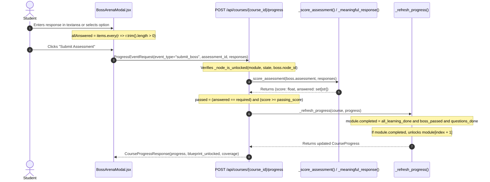

Analyzed BossArenaModal.jsx:L1-100
Analyzed BossArenaModal.jsx:L101-247
Errored list frontend files
Analyzed App.jsx:L1-100
Analyzed App.jsx:L101-250
Analyzed NodePlayerModal.jsx:L1-100
Errored search for Verify button in frontend
Analyzed NodePlayerModal.jsx:L800-940
Analyzed NodePlayerModal.jsx:L150-300
Analyzed NodePlayerModal.jsx:L301-450
Analyzed NodePlayerModal.jsx:L500-650
Analyzed NodePlayerModal.jsx:L651-800
Analyzing test_main.py:L1-50
Analyzing test_backend.py:L1-50

### Forensic Investigation: Boss Assessment Completion & Module Unlocking

This is an end-to-end trace of the Boss assessment completion and progression pipeline across the frontend modal, the REST endpoint, and the internal scoring and progression functions in `gamified-course-prototype`.

---

### Core Components and Execution Chain



---

### Key Source Locations & Implementation Details

1. **`BossArenaModal.jsx`** ([`frontend/src/components/BossArenaModal.jsx`](file:///c:/Users/Code/Desktop/DoubtDesk/prototypes/gamified-course-prototype/frontend/src/components/BossArenaModal.jsx#L30-L49)):
   - **Validation**:
     ```javascript
     const allAnswered =
       items.length > 0 &&
       items.every((item) => (responses[item.assessment_item_id] || '').trim().length > 0)
     ```
   - **Submission Trigger**:
     ```javascript
     const submit = async () => {
       if (!allAnswered || submitting) return
       setSubmitting(true)
       try {
         const assessmentId = assessment.assessment_id || `assess_${node.node_id}`
         const res = await onSubmitAssessment(assessmentId, responses)
         setResult(res)
       } ...
     }
     ```
   - **Button State**:
     The primary action button is labeled `Submit Assessment` and is controlled by:
     `disabled={!allAnswered || submitting || blueprintUnlocked}`.

2. **`POST /api/courses/{course_id}/progress`** ([`backend/main.py`](file:///c:/Users/Code/Desktop/DoubtDesk/prototypes/gamified-course-prototype/backend/main.py#L911-L924)):
   ```python
   elif event.event_type == "submit_boss":
       boss = next((node for node in module.nodes if node.node_type == "boss" and node.assessment and node.assessment.assessment_id == event.assessment_id), None)
       if boss is None or boss.assessment is None or not _node_is_unlocked(module, state, boss.node_id):
           raise HTTPException(status_code=403, detail="Boss prerequisites are not satisfied.")
       score, answered = _score_assessment(boss.assessment, event.responses)
       required = {item.assessment_item_id for item in boss.assessment.items}
       passed = answered == required and score >= boss.assessment.passing_score
       state.boss_progress = BossProgress(
           assessment_id=boss.assessment.assessment_id,
           started=True,
           submitted=True,
           score=score,
           passed=passed,
           answered_item_ids=sorted(answered),
           responses={key: value for key, value in event.responses.items() if value.strip()},
           submitted_at=_now(),
           blueprint_unlocked=passed,
       )
       state.assessed_question_ids = sorted({
           question_id
           for item in boss.assessment.items
           if item.assessment_item_id in answered
           for question_id in item.original_question_ids
           if question_id in state.required_question_ids
       })
   progress = _refresh_progress(course, progress)
   course = _apply_coverage(course, progress)
   ```

3. **`_score_assessment()`** ([`backend/main.py`](file:///c:/Users/Code/Desktop/DoubtDesk/prototypes/gamified-course-prototype/backend/main.py#L788-L804)):
   ```python
   def _score_assessment(assessment: BossAssessment, responses: dict[str, str]) -> tuple[float, set[str]]:
       scores: list[float] = []
       answered: set[str] = set()
       for item in assessment.items:
           response = responses.get(item.assessment_item_id, "").strip()
           if not response:
               scores.append(0.0)
               continue
           answered.add(item.assessment_item_id)
           if item.accepted_answers:
               scores.append(float(response.casefold() in {answer.casefold() for answer in item.accepted_answers}))
           elif item.correct_answer:
               scores.append(float(response.casefold() == item.correct_answer.casefold()))
           else:
               scores.append(float(_meaningful_response(item.prompt, response)))
       return (sum(scores) / len(scores) if scores else 0.0), answered
   ```

4. **`_meaningful_response()`** ([`backend/main.py`](file:///c:/Users/Code/Desktop/DoubtDesk/prototypes/gamified-course-prototype/backend/main.py#L782-L786)):
   ```python
   def _meaningful_response(prompt: str, response: str) -> bool:
       prompt_words = {word.casefold() for word in re.findall(r"[A-Za-z0-9]{4,}", prompt)}
       answer_words = {word.casefold() for word in re.findall(r"[A-Za-z0-9]{4,}", response)}
       return len(response.strip()) >= 20 and bool(prompt_words & answer_words)
   ```

5. **`_refresh_progress()`** ([`backend/main.py`](file:///c:/Users/Code/Desktop/DoubtDesk/prototypes/gamified-course-prototype/backend/main.py#L806-L824)):
   ```python
   all_learning_done = all(item.completed for item in state.node_progress if node_map[item.node_id].node_type == "stepping_stone")
   boss_passed = bool(state.boss_progress and state.boss_progress.submitted and state.boss_progress.passed)
   questions_done = set(state.required_question_ids).issubset(set(state.assessed_question_ids))
   state.completed = all_learning_done and boss_passed and questions_done
   if state.completed:
       state.completed_at = state.completed_at or _now()
       completed_ids.add(state.module_id)
   dependencies = module.dependency_module_ids or ([ordered[index - 1].module_id] if index else [])
   state.unlocked = not dependencies or all(dependency in completed_ids for dependency in dependencies)
   ```

---

### Scenario-by-Scenario Forensic Audit

*(Assumptions for all scenarios below: The student has previously completed all stepping-stone nodes in Module 1, so `_node_is_unlocked(module, state, boss.node_id)` evaluates to `True`, and `all_learning_done == True`. Default `boss.assessment.passing_score == 0.70`).*

---

#### Scenario 1: Student Submits No Response
* **Payload**: `{"event_type": "submit_boss", "assessment_id": "assess_id", "responses": {}}`
* **Frontend UI State**:
  - In `BossArenaModal.jsx` line 32, `allAnswered` is `false`.
  - The `Submit Assessment` button is **disabled**.
  - If bypassed directly via API client:
* **Trace in `_score_assessment()`**:
  - `response = responses.get(item_id, "").strip()` evaluates to `""`.
  - Enters `if not response:`: appends `0.0` to `scores`.
  - `answered.add(...)` is **skipped**.
  - Returns `(score=0.0, answered=set())`.
* **Backend Outcome**:
  - `answered == required` is `False`.
  - `score >= 0.70` is `False` (`0.0 >= 0.70`).
  - `passed = False`.
  - `state.boss_progress`: `score=0.0`, `passed=False`, `blueprint_unlocked=False`.
  - `state.assessed_question_ids`: `[]` (empty).
* **Progression State**:
  - In `_refresh_progress()`: `boss_passed == False`, `questions_done == False`.
  - `state.completed`: `False`.
  - **Module 2 Remains Locked**: `state.unlocked == False` (`"Waiting for prerequisite module completion and a passing Boss assessment."`).

---

#### Scenario 2: Student Submits an Empty / Whitespace-Only Response
* **Payload**: `{"event_type": "submit_boss", "assessment_id": "assess_id", "responses": {"item_1": "   \n\t  "}}`
* **Frontend UI State**:
  - `(responses[item_id] || '').trim().length > 0` is `false`.
  - `allAnswered` is `false`; button is **disabled**.
* **Trace in `_score_assessment()`**:
  - `response = responses.get(item_id, "").strip()` produces `""`.
  - Enters `if not response:`: appends `0.0` to `scores`, does not add to `answered`.
  - Returns `(score=0.0, answered=set())`.
* **Backend Outcome**:
  - `answered == required` is `False`.
  - `score = 0.0`, `passed = False`.
  - `state.boss_progress.blueprint_unlocked = False`.
* **Progression State**:
  - `state.completed = False`.
  - **Module 2 Remains Locked**.

---

#### Scenario 3: Student Submits an Irrelevant 20+ Character Response
* **Example**:
  - **Prompt**: `"Explain the architecture of Brain-Computer Interfaces and signal acquisition."`
  - **Prompt Words (>=4 chars)**: `{"explain", "architecture", "brain", "computer", "interfaces", "signal", "acquisition"}`
  - **Response**: `"the brown fox jumps over twenty lazy dogs"` (42 characters; words: `{"brown", "jumps", "over", "twenty", "lazy", "dogs"}`).
* **Frontend UI State**:
  - `.trim().length > 0` is `true`. `allAnswered` is `true`.
  - The `Submit Assessment` button is **enabled**.
* **Trace in `_score_assessment()`**:
  - `response.strip()` is non-empty -> `answered.add("item_1")`.
  - Falls to `else`: calls `_meaningful_response(item.prompt, response)`.
  - In `_meaningful_response()`:
    1. `len(response.strip()) >= 20` -> `42 >= 20` is `True`.
    2. `prompt_words & answer_words` -> Set intersection is `set()` (empty).
    3. `bool(prompt_words & answer_words)` evaluates to `False`.
    4. Returns `False`.
  - `scores.append(float(False))` -> appends `0.0`.
  - Returns `(score=0.0, answered={"item_1"})`.
* **Backend Outcome**:
  - `answered == required` is `True`.
  - `score >= 0.70` (`0.0 >= 0.70`) is **`False`**.
  - `passed = False`.
  - `state.boss_progress`: `score=0.0`, `passed=False`, `blueprint_unlocked=False`.
  - *Note on side effect*: `state.assessed_question_ids` **does** record the question ID because `item.assessment_item_id in answered` is `True`.
* **Progression State**:
  - In `_refresh_progress()`: `boss_passed == False`.
  - `state.completed = False`.
  - **Module 2 Remains Locked**.

---

#### Scenario 4: Student Submits Keywords from the Question with No Understanding
* **Example**:
  - **Prompt**: `"Explain the architecture of Brain-Computer Interfaces and signal acquisition."`
  - **Prompt Words (>=4 chars)**: `{"explain", "architecture", "brain", "computer", "interfaces", "signal", "acquisition"}`
  - **Response**: `"I have no idea about architecture or signal. 1234567890"` (53 characters).
* **Frontend UI State**:
  - `.trim().length > 0` is `true`. `allAnswered` is `true`.
  - Button is **enabled**.
* **Trace in `_score_assessment()`**:
  - `response.strip()` is non-empty -> `answered.add("item_1")`.
  - Calls `_meaningful_response(item.prompt, response)`.
  - In `_meaningful_response()`:
    1. `len(response.strip()) >= 20` -> `53 >= 20` is `True`.
    2. `answer_words` contains: `{"have", "idea", "about", "architecture", "signal", "1234567890"}`.
    3. `prompt_words & answer_words` -> `{"architecture", "signal"}` (non-empty!).
    4. `bool(prompt_words & answer_words)` evaluates to **`True`**.
    5. Returns **`True`**.
  - `scores.append(float(True))` -> appends **`1.0`** (100% full marks).
  - Returns `(score=1.0, answered={"item_1"})`.
* **Backend Outcome**:
  - `answered == required` is `True`.
  - `score >= 0.70` (`1.0 >= 0.70`) is **`True`**.
  - **`passed = True`**.
  - `state.boss_progress`: `score=1.0`, `passed=True`, `blueprint_unlocked=True`.
* **Progression State**:
  - In `_refresh_progress()`:
    1. `all_learning_done` is `True`.
    2. `boss_passed` is `True`.
    3. `questions_done` is `True`.
  - `state.completed = True` (sets `completed_at`).
  - **Module 2 Unlocks Immediately**: `state.unlocked` for Module 2 changes from `False` to `True` (`unlock_reason: "All configured prerequisite modules are complete."`).
* **Critical Finding**:
  **The assessment can be completely bypassed.** Any arbitrary 20-character string containing a single 4-letter word copied from the prompt (e.g. `"architecture 1234567890"`) receives an automatic score of `1.0`, passes the boss assessment, unlocks the official examination answer blueprint, marks the module complete, and unlocks the next module.

---

#### Scenario 5: Student Answers an Objectively Scored MCQ Correctly
* **Condition**: Item has `item.correct_answer = "opt_1"` or `item.accepted_answers = ["opt_1"]`. Student submits `{"item_1": "opt_1"}`.
* **Frontend UI State**:
  - Option is selected. `allAnswered` is `true`. Button is **enabled**.
* **Trace in `_score_assessment()`**:
  - `answered.add("item_1")`.
  - Enters `elif item.correct_answer:`:
    `response.casefold() == item.correct_answer.casefold()` -> `"opt_1" == "opt_1"` is `True`.
  - Appends `1.0` to `scores`.
  - Returns `(score=1.0, answered={"item_1"})`.
* **Backend Outcome**:
  - `answered == required` is `True`.
  - `score >= 0.70` is `True`.
  - `passed = True`.
  - `state.boss_progress.passed = True`, `state.boss_progress.blueprint_unlocked = True`.
* **Progression State**:
  - `_refresh_progress()` sets `state.completed = True`.
  - **Module 2 Unlocks Immediately**.

---

#### Scenario 6: Student Answers an Objectively Scored MCQ Incorrectly
* **Condition**: `item.correct_answer = "opt_1"`. Student selects `"opt_2"`.
* **Frontend UI State**:
  - Option selected. Button is **enabled**.
* **Trace in `_score_assessment()`**:
  - `response` is `"opt_2"` -> `answered.add("item_1")`.
  - `response.casefold() == item.correct_answer.casefold()` -> `"opt_2" == "opt_1"` is `False`.
  - Appends `0.0` to `scores`.
  - Returns `(score=0.0, answered={"item_1"})`.
* **Backend Outcome**:
  - `answered == required` is `True`.
  - `score >= 0.70` is `False`.
  - `passed = False`.
  - `state.boss_progress.passed = False`, `blueprint_unlocked = False`.
* **Progression State**:
  - In `_refresh_progress()`: `boss_passed == False`.
  - `state.completed = False`.
  - **Module 2 Remains Locked**.

---

### Investigation of the "Verify" / Submit Button & Payload Bypasses

1. **Button Behavior in `BossArenaModal.jsx`**:
   - The button is labeled `"Submit Assessment"` (line 241).
   - The button is gated strictly by:
     `disabled={!allAnswered || submitting || blueprintUnlocked}`
   - Because `allAnswered` checks only `(responses[item_id] || '').trim().length > 0`, typing a single letter (e.g. `"a"`) in each textarea enables the submit button.
2. **Payload Submitted**:
   ```json
   {
     "event_type": "submit_boss",
     "assessment_id": "module_1_assessment",
     "responses": {
       "module_1_assessment_1": "a"
     }
   }
   ```
3. **Can the Frontend Button Submit Without Genuinely Answering?**
   - **Yes, it can be clicked and sent**: The UI does not validate answer length or keyword presence. A student can click Submit with `"a"`.
   - **However, backend validation catches single-character inputs**:
     When the backend receives `"a"`, `len("a".strip()) < 20`, so `_meaningful_response` returns `False`, scoring it `0.0`. The submission **fails** backend evaluation.
   - **The Real Vulnerability**:
     The student does not need to answer genuinely. Submitting any string of 20+ characters that re-quotes a single word from the question (e.g. `"Define 0123456789012345"`) is accepted by the frontend, awarded `1.0` (100%) by the backend, unlocks the examination blueprint, and completes the module.

---

### Root Cause Summary Table

| Step | Function / Component | File Path | Code Mechanism | Root Cause / Vulnerability |
| :--- | :--- | :--- | :--- | :--- |
| **1. UI Gate** | `BossArenaModal` | `frontend/src/components/BossArenaModal.jsx:30-33` | `allAnswered = items.every(i => (responses[i] \|\| '').trim().length > 0)` | Frontend only checks for non-empty string. It does not enforce length or quality before enabling submit. |
| **2. Scoring Fallback** | `_meaningful_response` | `backend/main.py:782-786` | `len(response.strip()) >= 20 and bool(prompt_words & answer_words)` | **Flawed heuristic**: Grants full marks (1.0) for any 20-character string sharing one 4+ letter word with the prompt. No semantic or LLM grading exists. |
| **3. Pass Gate** | `record_progress` | `backend/main.py:917` | `passed = answered == required and score >= boss.assessment.passing_score` | Requires 70% average. Single-item boss nodes pass completely if `_meaningful_response` evaluates to True. |
| **4. Module Unlock** | `_refresh_progress` | `backend/main.py:815-820` | `state.completed = all_learning_done and boss_passed and questions_done` | Once `boss_passed` is True, `state.completed` becomes True and unlocks subsequent modules without teacher review. |